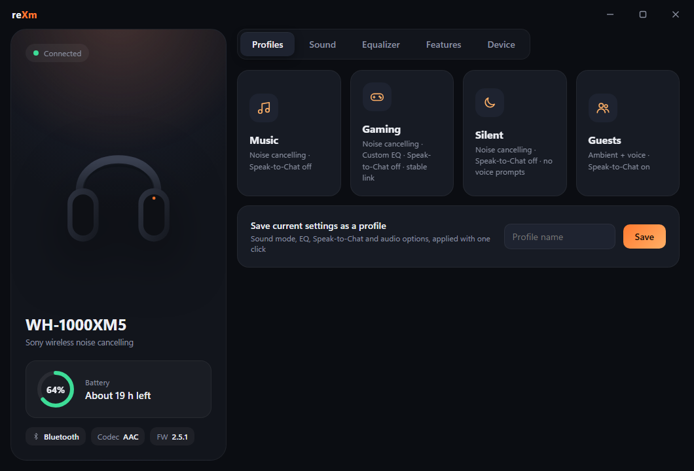

# reXm

**Desktop control for Sony WH/WF-1000XM headphones — on Windows and Linux.**
Sony only makes a phone app. reXm talks to the headphones directly over Bluetooth, so you can change
noise cancelling, EQ and everything else from your PC.



## Download

Get the latest version from **[Releases](../../releases/latest)**:

| System | File | How |
|---|---|---|
| Windows 10/11 | `reXm-Setup-<version>.exe` | Double-click and follow the installer (no admin needed) |
| Linux (Mint 21+, Ubuntu 22.04+) | `rexm_<version>_all.deb` | Double-click → **Install** |

> Windows SmartScreen may say *"Windows protected your PC"* because the installer isn't code-signed yet.
> Click **More info → Run anyway**.

## Features

- **Sound modes** — noise cancelling, ambient sound (level 1–20, focus on voice), off
- **Equalizer** — all presets plus a 6-band custom EQ with a live curve
- **Speak-to-Chat** — on/off, voice sensitivity, resume delay
- **Profiles** — Music, Gaming, Silent, Guests, or save your own; one click applies everything
- **NC/AMB button** — choose what the button cycles through
- **Features** — pause when taken off, DSEE Extreme, sound-quality vs stable connection, voice guidance, auto power off
- **Battery, codec, firmware** at a glance; **tray icon** with quick mode switching and low-battery alerts
- **Debug log** built in, for troubleshooting
- Settings live in the headphones, so they carry over to your phone

### Supported headphones

| Generation | Models | Status |
|---|---|---|
| XM5 generation | WH-1000XM5, WH-1000XM6, WF-1000XM5 | Supported (tested on WH-1000XM5) |
| XM3 / XM4 generation | WH-1000XM3, WH-1000XM4, WF-1000XM3/XM4 | Detected, not supported yet |

Google Assistant / Alexa on the headset only work through the phone apps — that's a Sony limitation.

## Run from source

Python 3.10+.

**Windows**
```
pip install pywebview pystray pillow winrt-runtime winrt-Windows.Devices.Bluetooth winrt-Windows.Devices.Bluetooth.Rfcomm winrt-Windows.Devices.Enumeration winrt-Windows.Foundation winrt-Windows.Foundation.Collections winrt-Windows.Storage.Streams winrt-Windows.Networking.Sockets winrt-Windows.Networking
python rexm.py
```

**Linux** (Mint / Ubuntu)
```
sudo apt install python3-gi gir1.2-webkit2-4.1 python3-pil python3-xlib gir1.2-ayatanaappindicator3-0.1
pip install --user pywebview pystray
python3 rexm.py
```

Pair the headphones with your computer first. Flags: `--background` starts in the tray, `--debug` opens dev tools.

### Building

- **Windows exe:** `pyinstaller --noconfirm --windowed --name reXm --icon rexm.ico --add-data "ui;ui" --collect-all winrt --collect-all webview --collect-submodules pystray --hidden-import bt_windows rexm.py`
- **Windows installer:** [Inno Setup 6](https://jrsoftware.org/isinfo.php) → `ISCC packaging\reXm.iss`
- **Linux .deb:** `sh packaging/build_deb.sh <version>`

## How it works

Sony headphones expose a vendor control service over Bluetooth RFCOMM. reXm finds it by its service UUID
(never by scanning channels — that can lock the headset up until it's power-cycled), then exchanges small
framed messages: `0x3E <type> <seq> <len> <payload> <checksum> 0x3C`. `sony.py` has the framing,
`bt_windows.py` / `bt_linux.py` the per-OS Bluetooth, `rexm.py` the commands and app, `ui/` the interface.

The message format and command codes were documented by the open-source
**[Gadgetbridge](https://codeberg.org/Freeyourgadget/Gadgetbridge)** project — huge thanks to them.

## Support

reXm is free. If it saves you reaching for your phone, a donation keeps development going:
**PayPal → fallen4500x@outlook.com**

## Disclaimer

reXm is an independent, unofficial project. It is not affiliated with, endorsed by or sponsored by Sony.
"Sony", "WH-1000XM5" and related names are trademarks of Sony Group Corporation, used here only to
describe compatibility. Use at your own risk.

© 2026 kurushimu — see [LICENSE](LICENSE). Third-party components: [THIRD_PARTY_NOTICES.md](THIRD_PARTY_NOTICES.md).
